<picture>
  <source media="(prefers-color-scheme: dark)" srcset="assets/header-dark.svg">
  
</picture>

I like building software that shows its reasoning. A scam filter that tells you *why* an email is dangerous. A cyclone model that says how sure it is. A study planner that actually reads your syllabus.

Most of my projects start as a sketch in my notebook.

### Things I've built

<a href="https://github.com/binayakmandal-hash/PRISM-TC">
  <picture>
    <source media="(prefers-color-scheme: dark)" srcset="assets/prism-tc-dark.svg">
    
  </picture>
</a>

<a href="https://github.com/binayakmandal-hash/scamshield-ai">
  <picture>
    <source media="(prefers-color-scheme: dark)" srcset="assets/scamshield-dark.svg">
    
  </picture>
</a>
<a href="https://github.com/binayakmandal-hash/smart-study-planner">
  <picture>
    <source media="(prefers-color-scheme: dark)" srcset="assets/study-planner-dark.svg">
    
  </picture>
</a>

Try them live: [ScamShield AI](https://scamshield-ai-yln0.onrender.com) and [Smart Study Planner](https://smart-study-planner-3wz3.onrender.com). They're on Render's free tier, so the first load can take about a minute.

I also work on [Stuck Doctor](https://github.com/KK-Dev0/Stuck_Doctor) for Hacktoberfest 2026, which helps people who keep putting off a doctor's visit actually book one. My first complete web project was [UniCalc](https://github.com/binayakmandal-hash/unicalculator), five student calculators in one Flask app.

### What I'm working on

- Getting better at data structures and algorithms in Python
- Planning **Thinkboard**, a real-time whiteboard where an AI joins as a teammate
- Smart India Hackathon 2026 with team VAYUVEGA

### Tools I use

<picture>
  <source media="(prefers-color-scheme: dark)" srcset="https://skillicons.dev/icons?i=py,pytorch,sklearn,flask,js,html,css,java,php,mysql,sqlite,git,docker,githubactions&theme=dark">
  
</picture>

### A year of commits

<picture>
  <source media="(prefers-color-scheme: dark)" srcset="https://raw.githubusercontent.com/binayakmandal-hash/binayakmandal-hash/output/snake-dark.svg">
  
</picture>

### Get in touch

Email me at [binayakmandal.asl@gmail.com](mailto:binayakmandal.asl@gmail.com). I'm open to internships in AI and backend engineering.
